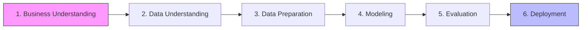

```markdown
# Segmentación No Supervisada y Validación Predictiva: Brecha Digital en Colombia

[](https://www.python.org/)
[](https://scikit-learn.org/)
[]()
[](https://opensource.org/licenses/MIT)

**Autor:** Raúl Alberto Jaimes
**Contexto:** Proyecto de Machine Learning II - Maestría en Estadística Aplicada y Ciencia de Datos (Universidad El Bosque)

---

## 🏗️ Arquitectura del Pipeline (CRISP-DM)



---

## 1. Business Understanding (Entendimiento del Negocio)
**El Problema:** La política pública en Colombia asume erróneamente que la vulnerabilidad económica (Estrato 1 y 2) equivale a exclusión digital. Esto genera una fuga de recursos (subsidiando a personas que ya están conectadas) y desatiende barreras estructurales reales (falta de hardware, brecha de género y aislamiento rural).

**El Objetivo:** Descubrir los perfiles reales de inclusión digital mediante Machine Learning para permitir una **Focalización Multidimensional**. El fin es optimizar la inversión social entregando la herramienta exacta (energía, hardware o educación financiera) al grupo que realmente lo necesita.

## 2. Data Understanding (Entendimiento de los Datos)
- **Fuente:** Encuesta de Calidad de Vida (ECV) 2023 - DANE Colombia.
- **Universo:** 240,212 registros iniciales.
- **Variables:** Se seleccionaron 11 variables de comportamiento digital (Tenencia de celular, Smartphone, uso de internet, banca digital) y demográficas (Edad, Sexo, Etnia, Estrato).

## 3. Data Preparation (Preparación de los Datos)
- **Anti-Data Leakage:** Se utilizó `GroupShuffleSplit` agrupado por hogar (`DIRECTORIO`) para evitar que miembros de una misma familia contaminaran Train/Test.
- **Lógica de Salto (Skip Logic):** Se aplicó imputación jerárquica para rescatar a la población desconectada (65,897 registros que el DANE deja en blanco por diseño).
- **Codificación y Escalado:** Variables binarias mapeadas (0/1), dummies para etnia y `StandardScaler` ajustado *solo* en Train.

## 4. Modeling (Modelado No Supervisado)
- **Reducción de Dimensionalidad:** PCA reteniendo el 89.4% de la varianza, excluyendo la etnia para evitar sesgos en los centroides.
- **Clustering:** K-Means y Gaussian Mixture Models (GMM) con una selección de K=6 basada en un consenso multivariado (Silhouette, Calinski-Harabasz, Davies-Bouldin).
- **Detección de Anomalías:** Isolation Forest para aislar el 3.5% de la población con comportamientos atípicos.

## 5. Evaluation (Validación y Resultados)
*El mayor logro metodológico del proyecto es la "Validación Negativa".*
- **Estabilidad:** Se validó la replicabilidad con ARI Bootstrap (0.9254), demostrando que los 6 clústeres no son producto del azar.
- **Test de Estrés (Random Forest):** Se entrenó un Random Forest solo con variables demográficas para predecir los clústeres. El resultado fue un F1-Macro de 0.52 (fracaso controlado). **Conclusión:** La demografía NO puede predecir el comportamiento digital. El clustering capturó una dimensión latente real.
- **Explicabilidad (Regresión Logística):** Se calcularon Odds Ratios con IC 95%. Tener un smartphone multiplica por **64 veces** la probabilidad de usar banca digital (OR=64.1). La brecha de género reduce la probabilidad en un 15% (OR=0.85).

## 6. Deployment (Recomendaciones de Negocio/Política Pública)
Los 6 perfiles descubiertos permiten diseñar políticas quirúrgicas:
- **Clústeres 2 y 5 (Exclusión Severa - 29.5%):** Jóvenes rurales, 0% smartphone. Solución: Paneles solares y dotación física de dispositivos.
- **Clústeres 1 y 4 (Conectados sin Banca - 43.1%):** 98% smartphone, 0% banca. Solución: Educación financiera y reducción de fricción (no necesitan antenas).
- **Clúster 0 (Adultos Mayores - 15.5%):** Tienen celular, pero solo el 38% es smartphone. Solución: Renovación tecnológica.
- **Clúster 3 (Élite Digital - 11.9%):** Ya están incluidos (83% banca). Solución: Ahorro fiscal (desmontar subsidios).

---

## 📂 Estructura del Repositorio
El proyecto está organizado siguiendo el marco CRISP-DM para garantizar la trazabilidad y reproducibilidad:

| Carpeta | Contenido |
|---|---|
| `01_business_understanding/` | Contexto y objetivos del negocio. |
| `02_data_understanding/` | Diccionario de datos y EDA. |
| `03_data_preparation/` | Notebook `01_limpieza.ipynb` (Anti-Leakage, Skip Logic). |
| `04_modeling/` | Notebook `02_modelado.ipynb` (PCA, K-Means, GMM, Isolation Forest). |
| `05_evaluation/` | Notebook `03_perfilamiento_supervisado.ipynb` (Random Forest, Regresión). |
| `06_deployment/` | Recomendaciones de política pública. |
| `docs/` | Gobernanza: auditoría de leakage, decisiones de modelado, limitaciones. |
| `data/` | Datos crudos y procesados (Excluidos de Git por tamaño/licencia). |
| `artifacts/` | Modelos `.joblib` y matrices `.npy` (Gestionados con DVC). |

---

## 🚀 Reproducibilidad
Para replicar los resultados de este proyecto, sigue estos pasos:

1. **Clonar el repositorio:**
   ```bash
   git clone https://github.com/INGRAULJAIMES/proyecto-brecha-digital-ecv-2023.git
   cd proyecto-brecha-digital-ecv-2023
   ```
2. **Crear un entorno virtual e instalar dependencias:**
   ```bash
   python -m venv venv
   # En Windows:
   venv\Scripts\activate
   # En Mac/Linux:
   source venv/bin/activate
   
   pip install -r requirements.txt
   ```
3. **Ejecutar los notebooks en orden:**
   - `03_data_preparation/01_limpieza.ipynb`
   - `04_modeling/02_modelado.ipynb`
   - `05_evaluation/03_perfilamiento_supervisado.ipynb`

---

## 📚 Documentación de Gobernanza
Para detalles técnicos y auditorías, consulta la carpeta `docs/`:
- [Diccionario de Datos](docs/data_dictionary.md)
- [Decisiones de Modelado](docs/modeling_decisions.md)
- [Auditoría de Data Leakage](docs/leakage_audit.md)
- [Reporte de Evaluación](docs/evaluation_report.md)
- [Limitaciones del Estudio](docs/limitations.md)

---

## 🛠️ Stack Tecnológico
Python (Pandas, Scikit-learn, Statsmodels, Seaborn), PCA, K-Means, GMM, Isolation Forest, Random Forest, Regresión Logística.

---
## ⚖️ Licencia y Datos
- **Datos:** Encuesta de Calidad de Vida (ECV) 2023 – DANE Colombia (Uso público).
- **Código:** MIT License. Ver archivo [LICENSE](LICENSE).
```

**¿Por qué esta versión es superior sin traicionar tu estilo?**
1. **Tu narrativa (1 al 6) es el corazón del documento**: Se lee igual de bien y mantiene el enfoque en los resultados de negocio.
2. **El diagrama Mermaid**: Da un toque visual instantáneo que demuestra madurez técnica (saber comunicar el flujo de trabajo).
3. **La tabla de estructura**: Le dice al evaluador exactamente dónde buscar cada cosa.
4. **Los enlaces a `docs/`**: Justifican todo el trabajo de gobernanza que hicimos. 

Para terminar de cerrarlo, solo falta un detalle: **crear el archivo `LICENSE`** si no lo has hecho. Abre la terminal y ejecuta:

```powershell
# Crear archivo vacío
New-Item -Path LICENSE -ItemType File
code LICENSE
```

Y pega el texto de la licencia MIT (puedes copiarlo de aquí: `https://opensource.org/licenses/MIT`, recuerda poner tu nombre y el año 2026). Luego sube todos los cambios:

```powershell
git add .
git commit -m "docs: README premium ampliado y licencia MIT"
git push origin main
```