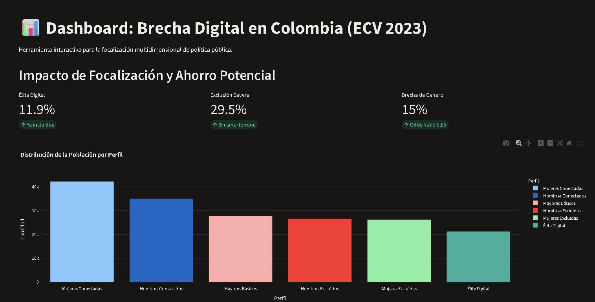
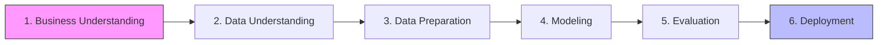

# Segmentación No Supervisada y Validación Predictiva: Brecha Digital en Colombia

[](https://www.python.org/)
[](https://scikit-learn.org/)
[]()
[](https://opensource.org/licenses/MIT)

**Autor:** Raúl Alberto Jaimes | **Contexto:** Maestría en Estadística Aplicada y Ciencia de Datos (Universidad El Bosque)

> **📌 Navegación por perfil:**
> - **Si eres reclutador, gerente o tomador de decisiones no técnico:** lee el **[Bloque 1 · Impacto de Focalización](#bloque-1)**.
> - **Si eres estadístico, científico de datos o jurado de maestría:** salta al **[Bloque 2 · Rigor Estadístico](#bloque-2)**.
> - **Si eres desarrollador o quieres replicar el pipeline:** ve al **[Bloque 3 · Estructura y Reproducibilidad](#bloque-3)**.

---
<a id="bloque-1"></a>
## 📊 Bloque 1: Impacto de Focalización y Ahorro Potencial

**TL;DR:** Este proyecto analizó a 178,993 colombianos y descubrió que la política actual de subsidiar internet "por estrato" es ineficiente. El **11.9% de la población ya está plenamente incluida digitalmente** y no necesita subsidio. El **29.5% no tiene ni celular ni energía formal**, por lo que un subsidio de datos móviles es inútil. La recomendación es **reasignar los recursos de los ya incluidos hacia infraestructura y hardware para los excluidos**.

### El Problema (En Lenguaje Simple)
La política pública asume que "Estrato 1 = Exclusión Digital". Los datos demuestran que esto es falso: hay personas de Estrato 1 que ya usan banca digital, y personas de Estrato 1 que no tienen ni celular. Dar un subsidio de datos a alguien sin smartphone es inútil; dárselo a alguien que ya está conectado es un desperdicio.

### El Hallazgo Clave (Tabla de Decisión)
| Perfil de la Población | ¿Qué % de la población es? | ¿Cuál es su realidad? | ¿Qué debería hacer el Estado? |
|---|---|---|---|
| **Élite Digital** (Ya incluidos) | **11.9%** | 83% usa banca digital y tiene smartphone. | **Reasignación potencial de recursos.** No requieren subsidios de conectividad. |
| **Conectados sin Banca** | **43.1%** | Tienen smartphone e internet, pero **0% usa banca digital**. | **Educación financiera**, no datos móviles. |
| **Exclusión Severa** | **29.5%** | **0% tiene smartphone.** El 8% depende de plantas eléctricas o conexiones informales (sin red formal). | **Paneles solares y dotación de celulares.** |
| **Adultos Mayores** | **15.5%** | Tienen celular, pero solo el **38% es smartphone**. | **Renovación tecnológica** (entregar smartphones). |

### La Decisión Recomendada (El "Qué Hacer")
> **No aumentar el presupuesto de subsidios de conectividad.** En su lugar, **reorientar** el gasto actual: suspender el subsidio para el 11.9% que ya está incluido y destinar ese ahorro a comprar hardware (celulares, paneles solares) para el 29.5% que no tiene ni dispositivo ni energía. Esto no requiere más dinero; requiere **mejor focalización**.

### Impacto Cualitativo (Lo que está en juego)
- **Si no se actúa:** Se seguirán gastando recursos en personas que ya están conectadas, mientras las zonas rurales sin energía quedan perpetuamente excluidas.
- **Si se actúa:** Cada peso invertido en hardware o energía para los excluidos tendrá un impacto medible en su inclusión digital, porque se ataca la barrera real.

### 🚀 Dashboard Interactivo
Puedes explorar los resultados de forma visual e interactiva en tiempo real:

<a href="https://proyecto-brecha-digital-ecv-2023.streamlit.app/" target="_blank">
  
</a>

> **[Haz clic aquí para abrir el Dashboard Interactivo completo](https://proyecto-brecha-digital-ecv-2023.streamlit.app/)**

<br>

---

<a id="bloque-2"></a>
## 🔬 Bloque 2: Rigor Estadístico y Ciencia de Datos

### Pipeline CRISP-DM


### Métricas de Validación (Con Interpretación)
| Métrica | Valor | ¿Qué significa en la práctica? |
|---|---|---|
| **ARI (Bootstrap)** | 0.9254 | Los 6 perfiles son **estables**: no cambian si se toma otra muestra aleatoria. |
| **ARI (K-Means vs GMM)** | 0.7306 | Dos algoritmos distintos encontraron **la misma estructura**. No es un artefacto. |
| **F1-Macro (Random Forest)** | 0.52 | **Validación negativa:** La demografía **no puede predecir** el perfil. Esto demuestra que el comportamiento digital es una dimensión oculta que el clustering sí capturó. |
| **Odds Ratio (Smartphone)** | 64.1 | Tener smartphone multiplica por **64** las *chances* (odds) de usar banca digital. Es la barrera más grande. |
| **Odds Ratio (Mujer)** | 0.85 | A igual estrato y hardware, ser mujer reduce las *chances* (odds) de usar banca en un **15%**. Brecha de género estructural. |
| **Pseudo-R² (McFadden)** | 0.166 | La demografía y el hardware explican solo el **16.6%** de la varianza. El **83.4%** restante es comportamiento latente, capturado por los clústeres. |

### Decisiones Metodológicas Clave
- **Exclusión de Etnia en PCA:** Se excluyó `P6080` para evitar que las minorías (alta varianza, baja frecuencia) secuestraran los componentes principales. Se usó post-hoc para perfilamiento.
- **Anti-Data Leakage:** `GroupShuffleSplit` agrupado por `DIRECTORIO`. `StandardScaler.fit()` solo en Train.
- **Consenso para K=6:** Filtro de accionabilidad (mínimo 5% por clúster) + ranking de Silhouette, Calinski-Harabasz y Davies-Bouldin.

### Limitaciones Declaradas
- **Pérdida de muestra:** El merge con la base de Vivienda perdió el **4.23%** de los registros (7,575 personas) por falta de georreferenciación.
- **Ausencia de geografía:** El modelo no incluye departamentos ni municipios; trata el territorio como homogéneo.
- **Supuestos geométricos:** K-Means asume clústeres esféricos; GMM asume gaussianas. No se exploraron formas no convexas.
- **Imputación lógica:** Se asumió que "sin celular → sin smartphone → sin internet". Es el diseño del DANE, pero es una aproximación.

---

<a id="bloque-3"></a>
## 📂 Bloque 3: Estructura del Repositorio y Reproducibilidad

| Carpeta | Contenido |
|---|---|
| `01_business_understanding/` | Contexto, objetivos SMART, stakeholders. |
| `02_data_understanding/` | Diccionario de variables, Skip Logic, EDA. |
| `03_data_preparation/` | Notebook de limpieza, estrategia de imputación. |
| `04_modeling/` | Notebook de PCA, K-Means, GMM, Isolation Forest. |
| `05_evaluation/` | Notebook de validación supervisada, Odds Ratios. |
| `06_deployment/` | Plan de acción de política pública. |
| `docs/` | Gobernanza (auditorías, decisiones, limitaciones, manifiesto de datos). |
| `data/` | Datos procesados e intermedios (raw excluido por tamaño). |
| `artifacts/models/` | Modelos `.joblib` y matrices `.npy`. |

### 🚀 Reproducibilidad (Quick Start)
```bash
# 1. Clonar el repositorio
git clone https://github.com/INGRAULJAIMES/proyecto-brecha-digital-ecv-2023.git
cd proyecto-brecha-digital-ecv-2023

# 2. Crear entorno e instalar dependencias
python -m venv venv

# Activar entorno (Windows):
venv\Scripts\activate
# Activar entorno (Mac/Linux):
source venv/bin/activate

pip install -r requirements.txt

# 3. Ejecutar notebooks en orden
# 03_data_preparation/01_limpieza.ipynb
# 04_modeling/02_modelado.ipynb
# 05_evaluation/03_perfilamiento_supervisado.ipynb
```
> **⚠️ Nota sobre datos crudos:** Los microdatos originales **no se incluyen** en este repositorio por su tamaño y para respetar las políticas de distribución del DANE. 

<br>

**Para reproducir el pipeline, siga estos pasos:**
> 1.  Consulte las fuentes oficiales y las instrucciones de descarga en **[docs/data_sources.md](docs/data_sources.md)**.
> 2.  Descargue los archivos `Caracteristicas Hogar y Tenencia TIC ECV 2023.csv` y el archivo `.DTA` de Vivienda.
> 3.  Colóquelos en la carpeta `data/raw/` antes de ejecutar los notebooks.

### 📚 Gobernanza y Documentación
- [Diccionario de Datos](docs/data_dictionary.md)
- [Decisiones de Modelado](docs/modeling_decisions.md)
- [Auditoría de Data Leakage](docs/leakage_audit.md)
- [Reporte de Evaluación](docs/evaluation_report.md)
- [Limitaciones del Estudio](docs/limitations.md)

### 📌 Topics del Repositorio (Descubribilidad en GitHub)
`crisp-dm` · `data-science` · `machine-learning` · `clustering` · `colombia` · `dane` · `python` · `scikit-learn`

---

## ⚖️ Licencia y Datos
- **Datos:** ECV 2023 – DANE Colombia (Uso público).
- **Código:** MIT License. Ver [LICENSE](LICENSE).
- **Citación:** Si usas este código o los hallazgos, cita: 
`Jaimes, R. A. (2026). Segmentación No Supervisada y Validación Predictiva: Brecha Digital en Colombia. GitHub.`

